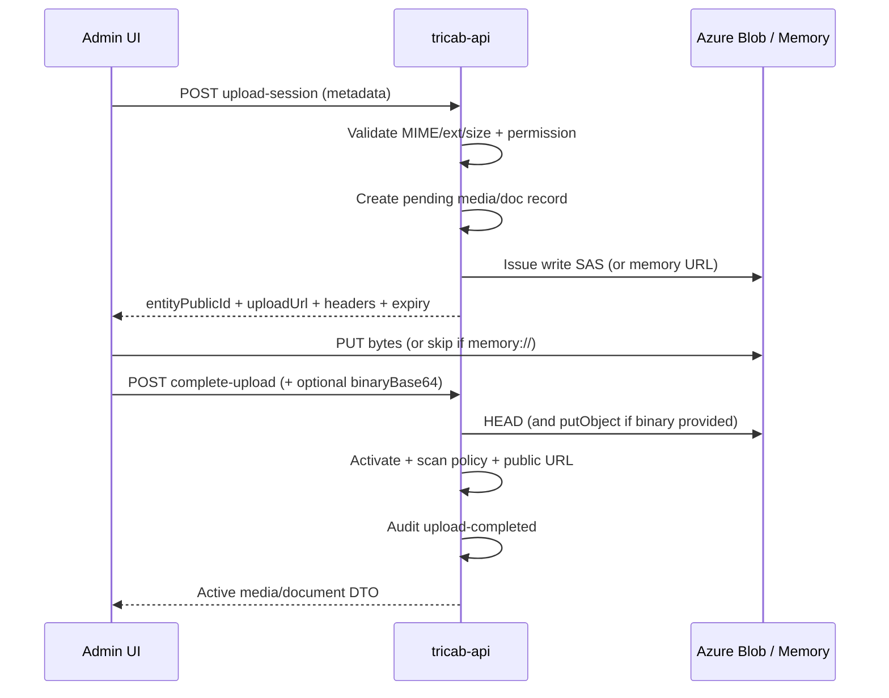

# TriCab Product Module — Phase 9: Azure Blob Storage and Product File Management

**Status:** Complete for non-production approval  
**Date:** 2026-08-06  
**Scope:** Secure product file uploads (images, documents, 360 frames, AR models). No ERP, legacy migration, Azure AI Search, pricing, or production deploy.

---

## 1. Storage architecture report

### Inspection findings
- No prior Azure Blob SDK, SAS issuer, CDN client, Key Vault, or malware-scan module existed in `tricab-api` / `tricab-core`.
- Product media/document tables already held storage metadata columns; Phase 9 extended upload/scan lifecycle fields.
- Core remains Azure-SDK-free. Blob adapters live only in `tricab-api`.
- Auth for Blob uses env-driven modes (never account keys in React).

### Modes (`BLOB_AUTH_MODE`)
| Mode | Use | Notes |
|------|-----|-------|
| `disabled` | Default / safe | Store operations throw; uploads unavailable |
| `memory` | Local/tests | In-memory blobs; `memory://` upload URLs; complete may accept `binaryBase64` |
| `connection-string` | Non-prod Azure | REST + account SAS (write-only, blob-scoped, short TTL) |

Production intent: Managed Identity + user-delegation SAS (not implemented in this phase; connection-string is non-prod only). Memory mode is forbidden when `APP_ENV=production`.

### Containers / path strategy
Logical container (default `products`, env `BLOB_CONTAINER_PRODUCTS`) with prefixes:

```
products/{productPublicId}/images/{mediaPublicId}/{filename}
products/{productPublicId}/documents/{documentPublicId}/{filename}
products/{productPublicId}/360/{setPublicId}/{frameNumber}-{filename}
products/{productPublicId}/ar/{mediaPublicId}/{filename}
products/{productPublicId}/tmp/{uploadSessionId}/{filename}   # reserved
```

Public IDs only — no internal integer IDs in blob paths.

---

## 2. Security model

- Short-lived, write-only, blob-path-scoped SAS (`BLOB_UPLOAD_SAS_TTL_SECONDS`, 60–3600).
- Download SAS TTL separate (`BLOB_DOWNLOAD_SAS_TTL_SECONDS`) for restricted documents.
- HTTPS only for Azure endpoints.
- MIME allowlist + extension allowlist + byte-size limits (`ProductFileValidationPolicy`).
- Completion verifies blob HEAD (size/content-type) before activating metadata.
- No account keys or long-lived SAS returned to React; tokens never audited.
- Public catalogue returns delivery URLs only for `uploadStatus=active` and scan in `{clean,not_required,skipped}`.
- Restricted documents require authenticated download via `GET /api/v1/products/{slug}/documents/{documentPublicId}/download`.

---

## 3. Upload sequence



---

## 4. API endpoint inventory

### Media (`PRODUCT.MEDIA.MANAGE`)
| Method | Path |
|--------|------|
| POST | `/api/v1/admin/products/{productPublicId}/media/upload-session` |
| POST | `/api/v1/admin/product-media/{mediaPublicId}/complete-upload` |
| POST | `/api/v1/admin/product-media/{mediaPublicId}/replace-upload` |
| DELETE | `/api/v1/admin/product-media/{mediaPublicId}/file` |

### Documents (`PRODUCT.DOCUMENTS.MANAGE`)
| Method | Path |
|--------|------|
| POST | `/api/v1/admin/products/{productPublicId}/documents/upload-session` |
| POST | `/api/v1/admin/product-documents/{documentPublicId}/complete-upload` |
| POST | `/api/v1/admin/product-documents/{documentPublicId}/replace-upload` |
| DELETE | `/api/v1/admin/product-documents/{documentPublicId}/file` |
| GET | `/api/v1/products/{slug}/documents/{documentPublicId}/download` |

### 360 (`PRODUCT.MEDIA.MANAGE`)
| Method | Path |
|--------|------|
| POST | `/api/v1/admin/products/{productPublicId}/360-sets` |
| POST | `/api/v1/admin/product-360-sets/{setPublicId}/frames/upload-session` |
| POST | `/api/v1/admin/product-360-frames/{framePublicId}/complete-upload` |
| POST | `/api/v1/admin/product-360-sets/{setPublicId}/activate` |

### AR (`PRODUCT.MEDIA.MANAGE`)
| Method | Path |
|--------|------|
| POST | `/api/v1/admin/products/{productPublicId}/ar-models/upload-session` |
| POST | `/api/v1/admin/product-ar-models/{arPublicId}/complete-upload` |

Request JSON uses `originalFileName` (not `fileName`). Complete may include `binaryBase64` for memory-mode fallback (media/documents).

---

## 5. Database changes (non-production only)

Script: `tricab-api/database/scripts/development/alter-product-file-upload-phase9.sql`  
(mirrored under `tricab-core/database/scripts/development/`)

Adds upload/scan/blob metadata columns on product images, documents, 360 frames, AR models, and creates `ProductFileUploadSessions` for session tracking.

**Do not apply to production.**

---

## 6. File-type and size-limit matrix

| Kind | Extensions | MIME (examples) | Max size |
|------|------------|-----------------|----------|
| Image | jpg, jpeg, png, webp | image/jpeg, image/png, image/webp | 20 MB |
| Document | pdf | application/pdf | 50 MB |
| CAD | dwg, dxf, step, stp, iges, igs | octet-stream / vendor types | 200 MB |
| AR | glb, usdz | model/gltf-binary, model/vnd.usdz+zip | 200 MB |
| 360 frame | jpg, jpeg, png, webp | image/* as images | 20 MB each |

360 set activation requires all expected frames uploaded (`active`/`uploaded`). Incomplete sets cannot activate.

---

## 7. Permission matrix

| Permission | Capabilities |
|------------|--------------|
| `PRODUCT.MEDIA.MANAGE` | Image/360/AR upload session, complete, replace, delete file, activate 360 |
| `PRODUCT.DOCUMENTS.MANAGE` | Document upload session, complete, replace, delete file; restricted download elevate |
| `PRODUCT.READ` | List admin media/documents (metadata) |
| Anonymous / guest | Public document download URLs only when access=public + clean/active |

---

## 8. Malware scanning strategy

| Env | `BLOB_SCAN_MODE` | Behaviour |
|-----|------------------|-----------|
| Local/tests | `auto-clean` | Mark `clean` immediately after verified upload |
| Staging/prod intent | `pending` / Defender | Leave `pending_scan` until Microsoft Defender for Storage (or Event Grid scanner) reports clean |

States: `pending_upload` → `uploaded`/`active` with scan `pending_scan` | `clean` | `rejected` | `failed` | `deleted`.

**Public delivery rule:** never expose files that are not `active` upload + allowed scan status.

Operational production checklist (not executed in Phase 9):
1. Enable Microsoft Defender for Storage on the product container.
2. Quarantine/reject handler updates `scanStatusCode`.
3. CDN only fronts clean objects (or API gates URLs).

---

## 9. Thumbnail strategy

- Original blob is never overwritten.
- Width/height extracted via GD (`getimagesizefromstring`) when binary available at complete.
- `thumbnailUrl` / web-optimised derivative columns are reserved; generation job is deferred.
- Until derivatives exist, Admin preview may use `publicUrl` of the original when clean/active.

---

## 10. Public / restricted delivery

- Public Product media/document APIs filter active + clean (or not_required/skipped) and public access for documents.
- Restricted docs: no public URL in catalogue; clients call authenticated download endpoint for a short-lived read SAS.
- CDN base: `BLOB_CDN_BASE_URL` (optional); otherwise blob HTTPS URL.

---

## 11. Cleanup strategy

| Item | Strategy |
|------|----------|
| Expired upload sessions | `ProductFileUploadSessions` + `uploadExpiresAtUtc`; operational sweeper (scheduled job) deletes pending metadata + orphan blobs after grace period (recommended 24–72h) |
| Abandoned temp blobs | Prefix `tmp/`; same sweeper |
| Replaced files | Old path marked `replaced`/`deleted`; delayed blob delete after retention |
| Soft-deleted media/docs | Soft-delete metadata first; blob purge after audit retention |

**Phase 9:** schema + status transitions support cleanup; automated sweeper is **operationally documented**, not scheduled in-app yet. Do not delete blobs still referenced by active metadata.

---

## 12. Audit events

Recorded (never includes SAS tokens):  
`upload-session-created`, `upload-completed`, `file-deleted`, `file-replaced`, 360 `created`/`activated`, AR upload events, primary-image changes via existing media services.

---

## 13. Admin UI

Product Admin Media and Documents panels support:
- File picker, client validation, XHR progress, cancel, replace, delete, preview, status display
- `originalFileName` request field; parses `uploadStatus` / `uploadStatusCode`
- Memory-mode complete via `binaryBase64` when direct PUT skipped

360/AR: HTTP APIs complete; dedicated Admin UI panels deferred (API-first). Media/document upload UX satisfies Phase 9 Admin progress requirement.

---

## 14. Test report

| Suite | Result |
|-------|--------|
| tricab-core `ProductFile\|Upload\|360\|ArModel` | 24 tests OK |
| tricab-api `ProductFileUploadEndpointsTest` | 11 tests OK (initiate, MIME, size, complete, permission, public filter, 360 incomplete/complete, AR invalid/complete, document complete) |
| tricab-web `ProductDetailsPage.test.tsx` | 5 tests OK |

Storage under test: `BLOB_AUTH_MODE=memory` (Azurite/disposable Azure account not required for CI).

---

## 15. Files created / modified (summary)

### tricab-core
- Domain: `UploadStatusCode`, `ScanStatusCode`, `ProductFileValidationPolicy`, path builder, blob/scan/image ports
- Services: Initiate/Complete/Replace/Delete media & documents; 360 set/frame/activate; AR initiate/complete; restricted download
- Unit tests for validation and upload services

### tricab-api
- Storage: `InMemoryProductBlobStore`, `AzureProductBlobStore`, SAS issuer, REST client, `DisabledProductBlobStore`
- Actions/routes for media, documents, 360, AR, download
- DI wiring in `ContainerFactory`; settings for blob/scan
- Schema alter script; HTTP tests

### tricab-web
- `blobUpload.ts`, resources API upload/replace/delete, Media/Documents panels with progress
- Payload field alignment: `originalFileName`; status parse aliases

---

## 16. Deployment requirements (non-prod)

1. Apply `alter-product-file-upload-phase9.sql` to disposable Azure SQL only.
2. Set `BLOB_AUTH_MODE=connection-string` (or `memory` for local), container name, CDN base, SAS TTLs, `BLOB_SCAN_MODE`.
3. Create storage container `products` (private); enable HTTPS; optional Defender for Storage on staging.
4. Ensure admin roles include `PRODUCT.MEDIA.MANAGE` / `PRODUCT.DOCUMENTS.MANAGE`.
5. Do **not** deploy or alter production DB/storage in this phase.

---

## 17. Rollback plan

1. Disable uploads: `BLOB_AUTH_MODE=disabled`.
2. Revert API/web deploy; leave schema columns (nullable) in place or restore DB backup of disposable DB only.
3. Orphan blobs in non-prod can be purged after confirmation; production untouched.

---

## 18. Remaining blockers / follow-ups

1. Managed Identity + user-delegation SAS (replace connection-string for production).
2. Automated upload-session / orphan-blob sweeper job.
3. Thumbnail / web-derivative generation pipeline.
4. Defender for Storage wiring to update `scanStatusCode` asynchronously.
5. Admin UI panels for 360 sets and AR models.
6. Azurite-backed integration test in CI (optional).
7. Apply Phase 9 schema to shared non-prod `tc` if not already applied.

---

## 19. Completion checklist

1. Existing Azure patterns reused (none prior; new adapters isolated to API) — **yes**
2. No credentials exposed to React — **yes**
3. Upload URLs short-lived and scoped — **yes**
4. Upload completion verified server-side — **yes**
5. MIME, extension, size validated — **yes**
6. Media/document metadata linked to Blob — **yes**
7. Public files filtered by visibility + scan — **yes**
8. Restricted documents require authorization — **yes**
9. Upload progress in Admin UI — **yes** (media/docs)
10. Replace and delete workflows — **yes** (media/docs)
11. Audit events recorded — **yes**
12. Cleanup implemented or operationally documented — **documented**
13. Tests pass — **yes**
14. No ERP / migration / AI Search — **yes**
15. Production deployment not performed — **yes**

**Phase 9 stopped pending approval.**
